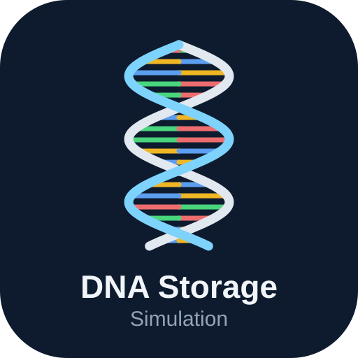
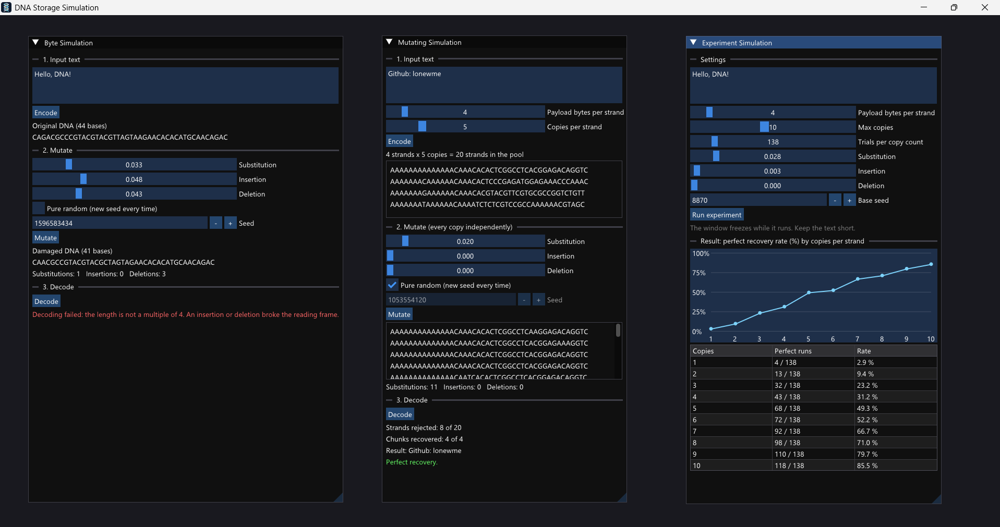

<p align="center">
  
</p>

<h1 align="center">DNA Storage Simulation</h1>

<p align="center">
  A C++17 simulator that stores text in DNA, damages it with random mutations,
  and measures how well redundancy can repair it.
</p>




## What it does

DNA can hold digital data at very high density, but real DNA gets damaged:
bases change, disappear, or appear from nowhere. This project simulates that
whole pipeline on a computer ("in silico"):

1. **Encode** text into the four DNA bases A, C, G, T.
2. **Mutate** the DNA with substitutions, insertions and deletions.
3. **Decode** the damaged DNA back into text and see what survived.
4. **Repair** the damage by splitting the data into checksummed strands and storing several copies of each.
5. **Measure** how often the text is recovered perfectly for different amounts of redundancy.

## How it works

### Encoding

Every byte becomes 4 bases (2 bits per base):

| Bits | 00 | 01 | 10 | 11 |
|---|---|---|---|---|
| Base | A | C | G | T |

The letter `A` is `01000001` in binary, so it becomes `CAAC`.

### Why damage is hard

A substitution corrupts one character. An insertion or deletion shifts the
reading frame, so everything after it turns into garbage, and the decoder
cannot even tell. That is why a single long strand is fragile.

### Repair: chunks, checksums and copies

The text is cut into chunks. Each chunk becomes its own short strand:

```
| index (2 B) | total (2 B) | length (1 B) | payload (N B) | CRC-16 (2 B) |
```

- The **CRC-16** checksum detects damage, so a broken strand is rejected instead of producing garbage.
- Damage stays **local**: a deletion destroys only its own strand.
- Several **copies** of every strand are stored and damaged independently. A chunk survives if at least one copy of it is intact.

## Results


Text `Hello, DNA!`, 4 payload bytes per strand, 2% substitution rate.
Perfect recovery rate by number of copies per strand:

| Copies | 1 | 2 | 3 | 4 | 5 | 6 | 7 | 8 |
|---|---|---|---|---|---|---|---|---|
| Theory (%) | 7.0 | 27.9 | 50.4 | 68.1 | 80.2 | 88.0 | 92.8 | 95.7 |
| Measured (%) | | | | | | | | |

The theory comes from `(1 - (1 - 0.98^44)^copies)^3`: a 44-base strand is
undamaged with probability 0.98^44, and there are 3 chunks.

## Project structure

```
core/         DNA logic (static library, no GUI code)
  include/dna/  Nucleotide, DnaSequence, FixedLengthCodec, Mutator, Crc,
                ChunkedCodec, Simulation, StrandSimulation, Experiment
  src/
app/          Dear ImGui user interface (only calls the core)
tests/        Unit tests (doctest)
docs/         Logo and screenshots
```

The core knows nothing about the interface, so every part of the simulation
is tested without opening a window.

## Build and run

Developed and tested on Windows 11 with MSYS2 (UCRT64), GCC, CMake and Ninja.
Other platforms are untested.

Install the tools in an **MSYS2 UCRT64** shell:

```bash
pacman -S --needed mingw-w64-ucrt-x86_64-gcc mingw-w64-ucrt-x86_64-cmake \
                   mingw-w64-ucrt-x86_64-ninja mingw-w64-ucrt-x86_64-gdb
```

Then build (the first configure downloads GLFW, Dear ImGui and doctest, so it needs internet):

```bash
git clone https://github.com/lonewme/dna-sim.git
cd dna-sim
cmake -S . -B build -G Ninja -DCMAKE_CXX_COMPILER=g++ -DCMAKE_C_COMPILER=gcc
cmake --build build
```

Run the tests and the application:

```bash
./build/dna_tests
./build/dna_sim
```

## The application

- **DNA Simulation**: one long strand, to see how an insertion or deletion breaks decoding.
- **Chunks + copies**: the repair pipeline, with sliders for strand size, copies and mutation rates.
- **Experiment**: runs hundreds of trials per copy count and plots the recovery rate.

Every mutation run uses a seed, so any result can be reproduced exactly. A
"Pure Random" option draws a new seed on every run and shows which seed was used.

## How this project was built


I built this as a first-year Computer Engineering student, working with an AI
assistant (Claude Sonnet 5.5) for design discussions and code. I set up the toolchain,
ran and tested every step, and made design decisions along the way. I always interested in storing datas in different ways.

## Roadmap

- Consensus voting: rescue a chunk when every copy is damaged, using the majority base at each position.
- Run the experiment on a background thread so the window never freezes.
- Stronger error-correcting codes (for example Reed-Solomon) and a comparison of their cost.

## License

MIT License. See [LICENSE](LICENSE).
